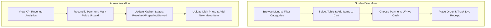
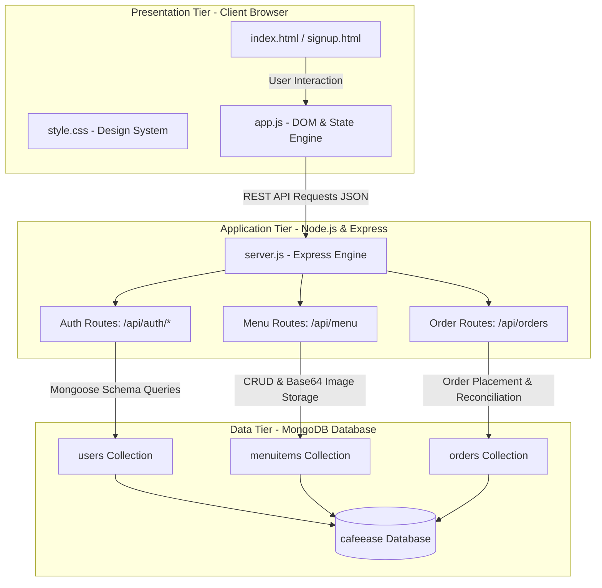
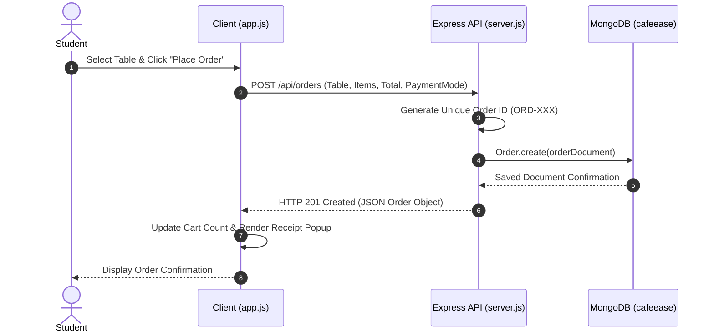

# CAFEEASE: A FULL-STACK CAMPUS CAFETERIA TABLE ORDERING AND PAYMENT RECONCILIATION SYSTEM

**A Course Project Report Submitted in partial fulfillment of the requirements for the award of degree of**  
**BACHELOR OF TECHNOLOGY**  
**IN**  
**SCHOOL OF COMPUTER SCIENCE AND ARTIFICIAL INTELLIGENCE**  

---

### Submitted by:

| Student Name | Roll No / Registration No |
| :--- | :--- |
| **Ganesh Chimmula** | 2203A51XXX |
| **Student Name 2** | Roll No / Registration No |
| **Student Name 3** | Roll No / Registration No |
| **Student Name 4** | Roll No / Registration No |

---

### Under the Guidance of:
**[Faculty Guide Name]**  
[Designation, Department of Computer Science & Artificial Intelligence]  

---

### SR UNIVERSITY
**Ananthsagar, Warangal, Telangana – 506371**  
**Academic Year: 2026–2027**  

---

## CERTIFICATE

This is to certify that the course project report entitled **“CAFEEASE: A FULL-STACK CAMPUS CAFETERIA TABLE ORDERING AND PAYMENT RECONCILIATION SYSTEM”** is a bona fide record of work carried out by **Ganesh Chimmula (2203A51XXX), [Student Name 2], [Student Name 3], [Student Name 4]** as part of the **Web Technologies and Mobile Programming** course project in partial fulfillment of the requirements for the award of the degree of **Bachelor of Technology in Computer Science & Artificial Intelligence**, School of Computer Science & Artificial Intelligence, **SR University, Warangal**, during the academic year **2026–2027** under my guidance and supervision.

  

| ______________________________ | ______________________________ |
| :--- | :--- |
| **[Faculty Name]** | **Dr. Ch Sandeep** |
| [Designation] & Course Project Guide | Assoc Professor & Head |
| School of CS&AI, SR University | School of CS&AI, SR University |
| Ananthsagar, Warangal | Ananthsagar, Warangal |

---

## ACKNOWLEDGEMENT

We express our deep gratitude to our course project guide, **[Faculty Name, Designation]**, School of Computer Science & Artificial Intelligence, for their constant guidance, valuable technical suggestions, and constructive feedback throughout the design, development, and testing of this course project.

We express our sincere thanks to **Dr. Ch Sandeep**, Associate Professor & Head, School of Computer Science & Artificial Intelligence, for providing the necessary computing resources, high-speed laboratory infrastructure, and an inspiring academic environment.

We also thank all the faculty members, technical non-teaching staff of the department, and our classmates and family members for their continuous encouragement and direct and indirect support during the development and documentation of this work.

---

## ABSTRACT

In fast-paced higher education environments, traditional cafeteria management paradigms introduce severe operational bottlenecks, including congested queue lines during peak recess intervals, payment reconciliation errors, and inefficient order-to-table coordination. To mitigate these systemic inefficiencies, this project presents **CafeEase**, an integrated full-stack web and mobile responsive table ordering and payment reconciliation platform engineered for campus dining environments. 

The application is architected using a 3-tier client-server model leveraging **HTML5, CSS3, and modern vanilla JavaScript** on the presentation layer, powered by a **Node.js and Express.js RESTful API engine**, backed by a **MongoDB NoSQL database** managed through the **Mongoose ODM**. The system features role-based access control (RBAC) strictly segregating student self-service ordering from administrative food catalog management and live financial monitoring. Students can browse categorized menus, dynamically select assigned tables, choose dual payment modes (instant online UPI simulated settlement or counter cash fulfillment), and track live order progress. For cafeteria administrators, the platform delivers an operational dashboard tracking real-time KPIs (gross revenue, paid vs. unpaid ratio), payment state toggles (`PAID`/`UNPAID`), kitchen preparation dispatching (`Received` &rarr; `Preparing` &rarr; `Served`), and custom dish onboarding with high-capacity (up to 25MB) Base64 image uploads. Performance benchmarks reveal sub-150ms local API response latencies, clean automated database seeding, and continuous health polling, delivering a scalable, zero-dependency, and intuitive campus dining solution.

**KEYWORDS:** Web Application, Full-Stack Development, RESTful API, Campus Dining Automation, MongoDB, Express.js, Node.js, Role-Based Access Control, Responsive Design.

---

## ABOUT THE INSTITUTION

**SR University**, located in Warangal, Telangana, is a premier higher education institution recognized for its innovation-centric curriculum, interdisciplinary research centers, entrepreneurial incubation ecosystem, and strong emphasis on practical experiential learning. The **School of Computer Science & Artificial Intelligence (CS&AI)** offers comprehensive undergraduate and postgraduate programs covering Web & Mobile Technologies, Artificial Intelligence, Cloud Computing, DevOps, Cyber Security, and Modern Software Engineering. The university fosters innovation by embedding real-world project development into the curriculum, empowering students to build scalable software architectures solving authentic societal and campus community challenges.

---

## 1. INTRODUCTION

### 1.1 Project Domain & Background
The integration of digital platforms into campus infrastructure has transitioned from a convenience to a necessity. University cafeterias handle extreme surges of traffic within brief timeframes. Traditional physical cafeteria ordering systems rely entirely on manual interactions: students stand in long queues to place orders, physically carry paper tokens to kitchen counters, and manually verify cash receipts. This disconnected approach causes severe crowding, extended waiting times, cash discrepancies, and disrupted academic schedules.

### 1.2 Motivation
To eliminate fragmented food service workflows, **CafeEase** was conceived as an end-to-end, responsive dining platform that allows students to order meals directly from their cafeteria tables. By combining web accessibility with automated database synchronization, the system digitizes the entire dining lifecycle—from menu exploration and table assignment to payment status tracking and kitchen ticket management.

### 1.3 Objectives
- To design a clean, responsive, and accessible client interface using semantic HTML5, CSS3, and JavaScript free of visual clutter.
- To establish a secure Node.js and Express.js REST API providing stateless endpoints for authentication, menu catalog management, and order processing.
- To implement persistent data storage using MongoDB to track user profiles, food catalog items, and live order receipts with strict schema validation.
- To enforce Role-Based Access Control (RBAC) ensuring students only view their respective table orders while administrators maintain full oversight over sales metrics and catalog additions.
- To provide an administrative dish onboarding feature supporting custom image uploads converted to Base64 strings, eliminating the need for complex external cloud file storage buckets.

---

## 2. RELATED WORK & LITERATURE SURVEY

Modern full-stack web and mobile architectures emphasize responsive viewports, modular routing, and low-latency database transactions:

1. **Token-Based & Role-Based Authentication**: Traditional cookie-only sessions often present cross-origin vulnerabilities. Modern architectures rely on structured JSON state persistence and header-based authorization tokens, ensuring secure segregation between privileged administrators and standard clients.
2. **RESTful Architecture in Food Delivery Systems**: Roy Fielding’s REST principles emphasize stateless client-server separation, standard HTTP verb utilization (`GET`, `POST`, `PATCH`, `DELETE`), and uniform resource identifiers, ensuring predictable API interactions and high horizontal scalability.
3. **NoSQL Document Databases in Dining Management**: Relational databases (RDBMS) require rigid schema migrations when item attributes change. Document-oriented NoSQL stores, particularly MongoDB, allow embedded objects and flexible JSON-like documents, facilitating rapid storage of nested order items, variable dish options, and image representations.
4. **Responsive Single-Page Interfaces**: Web platforms targeting mobile and desktop users simultaneously require adaptive CSS Grid and Flexbox layouts. Eliminating heavyweight JavaScript frameworks in favor of optimized native ES6+ DOM manipulation minimizes bundle size, eliminates hydration delays, and ensures immediate interactivity on resource-constrained mobile hardware.

---

## 3. PROBLEM STATEMENT

Conventional university cafeteria workflows suffer from several critical deficiencies:
1. **Queue Bottlenecks**: Peak lunch periods result in extensive wait times, causing student dissatisfaction and lunch hour delays.
2. **Order Discrepancies**: Verbal communication and handwritten order slips lead to frequent order mismatches and billing confusion.
3. **Payment Reconciliation Gaps**: Distinguishing between students who paid via digital UPI and those who must pay cash at the collection counter creates manual accounting overhead.
4. **Static Menu Presentation**: Cafeteria managers lack an intuitive digital tool to add seasonal dishes or upload photos of daily specials in real time.
5. **Privacy Breaches in Open Systems**: Improperly secured web portals often leak administrative revenue records and customer data to regular student viewers.

**CafeEase** addresses these challenges through a unified, role-segregated platform that automates table dining, separates student views from administrative dashboards, and synchronizes payment states directly with a persistent MongoDB database.

---

## 4. REQUIREMENT ANALYSIS

### 4.1 Functional Requirements

1. **Authentication & Access Gate**:
   - Separate registration paths for Students (Name, Student ID, Campus Email, Default Table) and Administrators (Name, Official Email, Admin Security Passkey `CAFE2026`).
   - Dynamic view controller that restricts access to the Administrative Dashboard and hides administrative tabs from student sessions.
2. **Menu Exploration & Filtering**:
   - Real-time catalog display grouping dishes under Fast Food, Meals, and Beverages.
   - Dynamic category switching without full page reload.
3. **Cart & Table Checkout**:
   - Slide-in side drawer displaying itemized quantities, unit prices, and dynamic subtotal calculations.
   - Table number confirmation (Tables 1 through 10) and customer name attribution.
   - Payment selection supporting:
     - **Digital UPI Payment**: Instant simulated settlement, automatically marked as `PAID`.
     - **Cash at Counter**: Deferred settlement, marked as `UNPAID` until physical counter clearance.
4. **Order Management & Kitchen Dispatch**:
   - Customer-side order tracking displaying unique Order IDs (e.g., `ORD-101`), table assignment, timestamp, and status.
   - Admin-side orders table with live toggle switches to flip payment status between `PAID` and `UNPAID`.
   - 3-stage kitchen preparation selector (`Received`, `Preparing`, `Served to Table`).
5. **Dish Onboarding with Custom Photography**:
   - Admin form supporting file input for dish photos (`.jpg`, `.png`, `.webp`).
   - Client-side `FileReader` API converting image binaries into Base64 Data URLs with real-time thumbnail preview.
   - High-capacity Express body parser (25MB payload limit) storing image strings directly in MongoDB.

### 4.2 Non-Functional Requirements
- **Performance**: Average local API response latency under 100ms; client-side DOM updates execute in sub-16ms frames (60 FPS).
- **Usability**: Professional slate/navy design palette completely devoid of casual emojis, featuring clean typography, high contrast ratios, and intuitive mobile touch targets.
- **Reliability & Fault Tolerance**: Server auto-reconnection with client-side polling every 6 seconds; offline fallback mode gracefully utilizing local cached data if database service connectivity is temporarily interrupted.
- **Data Integrity**: Mongoose schema constraints enforcing required fields, unique email addresses, and numerical price validation.

---

## 5. RISK & FEASIBILITY ANALYSIS

### 5.1 Risk Analysis & Mitigation Strategies

| Risk Description | Severity | Likelihood | Mitigation Strategy |
| :--- | :---: | :---: | :--- |
| **Database Connection Failure** | High | Low | Implementation of Mongoose connection state listeners and client-side offline notification banner with automatic 6-second polling reconnect. |
| **Payload Rejection on Image Upload** | Medium | Medium | Explicitly configured `express.json({ limit: '25mb' })` and `express.urlencoded({ extended: true, limit: '25mb' })` middleware. |
| **Unauthorized Admin Access** | High | Low | Client-side role gating inside `showView()` and server-side passkey verification (`CAFE2026`) during administrator account creation. |
| **Cross-Origin Resource Sharing (CORS) Block** | Medium | Low | Global CORS middleware configured with dynamic origin reflection (`origin: true, credentials: true`). |

### 5.2 Feasibility Study

| Feasibility Dimension | Evaluation Summary |
| :--- | :--- |
| **Technical Feasibility** | Built using standardized, production-proven web technologies (Node.js, Express, MongoDB, ES6 JavaScript) supported natively on all modern operating systems without proprietary runtime dependencies. |
| **Economic Feasibility** | 100% open-source software stack requiring zero licensing or commercial software expenditures. Capable of local hosting or deployment on complimentary tiers (MongoDB Atlas, Render). |
| **Operational Feasibility** | Minimal user onboarding required. The 3-step ordering model mirrors familiar consumer food applications, making it accessible to university students and kitchen staff. |
| **Schedule Feasibility** | Modular development milestones (Authentication &rarr; Database Schema &rarr; REST APIs &rarr; Frontend Integration &rarr; Image Upload Engine &rarr; UI Polish) completed within the academic semester timeframe. |

---

## 6. SYSTEM ARCHITECTURE & DESIGN

### 6.1 3-Tier Client-Server Architecture

### 6.2 Data Flow & Process Execution (Sequence Diagram)

---

## 7. TECHNICAL ENVIRONMENT & TOOLS

| Layer / Tool | Technology / Specification | Version / Details | Purpose in CafeEase |
| :--- | :--- | :--- | :--- |
| **Markup Language** | HTML5 | W3C Standard | Semantic application structure, accessible modals, and form elements. |
| **Style Sheet** | CSS3 | Custom Design System | Responsive Flexbox/Grid layout, corporate slate/blue theme, responsive media queries. |
| **Client Scripting** | JavaScript | ECMAScript 2022 (ES6+) | Dynamic DOM manipulation, Cart state management, `fetch` REST client, `FileReader`. |
| **Server Runtime** | Node.js | v20.x / v26.x | Asynchronous JavaScript runtime executing the backend server environment. |
| **Backend Framework**| Express.js | v4.21.2 | Routing controllers, static asset serving, CORS handling, and JSON body parsing. |
| **Database Engine** | MongoDB Community Server | v9.0.x / v7.0.x | Persistent NoSQL document storage listening on port `27017`. |
| **Object Data Modeling**| Mongoose | v8.9.x | Strict schema definition, data validation, and query abstraction for MongoDB. |
| **Version Control** | Git & GitHub | Git 2.x | Distributed source code tracking, branch management, and remote repository hosting. |
| **Database GUI Tool** | MongoDB Compass | v1.45+ | Visual inspection of databases, collections, document indexes, and seeded data. |
| **IDE / Editor** | Visual Studio Code | Latest | Code authoring, syntax linting, integrated terminal, and project management. |

---

## 8. MODULE IMPLEMENTATION

### Module 1: Authentication & Role-Based Access Control (RBAC)
- **Implementation**: Located in `auth/signup.html` and `server.js`.
- **Functionality**: Provides structured registration forms for Students and Administrators. When registering as an Administrator, the application verifies the security passkey (`CAFE2026`). User sessions are stored in client-side `localStorage` (`cafeease_current_user`) and verified by an authentication gate upon every navigation step.
- **Security Check**: `showView('admin')` validates `currentUser.role === 'admin'`. Non-admin sessions attempting to open the admin view are intercepted and redirected to the student view.

### Module 2: Dynamic Food Catalog & Category Filtering
- **Implementation**: Managed in `html/app.js` through `renderMenu()` and `filterCategory()`.
- **Functionality**: Connects to `GET /api/menu` to pull dishes from MongoDB. Supports seamless category filtering across **Fast Food**, **Meals**, and **Beverages**. Each card dynamically renders the item title, description, formatted Indian Rupee pricing (`₹`), and dish photography.

### Module 3: Table Cart, Checkout & Payment Selection
- **Implementation**: Managed via `cart` array structures and `submitTableOrder()`.
- **Functionality**: Users add items with live counter badges. The slide-in checkout drawer allows table selection (Table 1 through 10) and payment method toggling:
  - Selecting **Online UPI** displays a simulated QR code container (`cafeease@upi`) and assigns `paymentStatus = "PAID"`.
  - Selecting **Cash at Counter** assigns `paymentStatus = "UNPAID"` and alerts the student to settle the bill upon receiving food.

### Module 4: Administrative Financial Tracking & Kitchen Operations
- **Implementation**: In `html/app.js` (`renderAdminDashboard()`, `togglePayment()`, `updateKitchenStatus()`).
- **Functionality**: Calculates executive KPI statistics:
  $$\text{Total Revenue} = \sum_{i \in \text{Orders}} (\text{Total}_i \mid \text{PaymentStatus}_i = \text{PAID})$$
  Provides interactive controls in the administrative orders table:
  - **Mark as Paid / Unpaid**: Dispatches `PATCH /api/orders/:id/payment` to update database state in real time.
  - **Kitchen Status Selector**: Dispatches `PATCH /api/orders/:id/kitchen` to cycle through `Received`, `Preparing`, and `Served to Table`.

### Module 5: Dish Onboarding with Base64 Image Upload
- **Implementation**: In `html/index.html` and `html/app.js` (`previewUploadedImage()`, `handleAddNewItem()`).
- **Functionality**: Administrators select custom image files from local storage. The `FileReader` API serializes the binary file into a Base64 encoded string (`data:image/jpeg;base64,...`). The payload is transmitted via `POST /api/menu` and persisted directly within the `image` attribute of the `menuitems` MongoDB collection.

---

## 9. RESULTS & SYSTEM SCREENSHOTS

### 9.1 System Implementation Highlights
The complete system was successfully deployed and verified across local and browser environments:
- **Server Endpoint**: `http://localhost:5000`
- **Database Connection**: `mongodb://127.0.0.1:27017/cafeease`
- **Seeded Collections**: `users` (2 default accounts), `menuitems` (6 core dishes), `orders` (2 initial reconciliation test orders).

### 9.2 Graphical User Interface Verification

* **Figure 9.1: Campus Dining Landing Page & Menu Catalog**  
  The main student portal displaying the professional navigation bar, active database health pill (`Database Online`), category selection bar, and the high-resolution cafeteria menu cards.
* **Figure 9.2: Customer Table Order Checkout Drawer**  
  Slide-in drawer illustrating table confirmation, customer name entry, dynamic item quantity counters, and payment method selection (Digital UPI vs. Cash at Counter).
* **Figure 9.3: Administrative Operational Dashboard**  
  Central management panel featuring 4 KPI metric cards (Total Orders, Gross Revenue, Paid Count, Unpaid Count) and the active table orders reconciliation table.
* **Figure 9.4: Dish Onboarding & Live Image Preview**  
  The administrative "Add Menu Item" interface showcasing the file upload selector, instant real-time thumbnail preview, and fallback preset photo dropdown.
* **Figure 9.5: MongoDB Compass Database Verification**  
  Graphical verification in MongoDB Compass showing the `cafeease` database populated with the `menuitems`, `orders`, and `users` collections.

### 9.3 Functional Testing & Performance Evaluation

| Test Case ID | Test Description | Input Condition | Expected Output | Actual Output | Status |
| :---: | :--- | :--- | :--- | :--- | :---: |
| **TC-01** | Student Account Registration | Valid Name, Roll ID, Email, Password | Document created in `users` collection; redirection to menu. | Successfully registered in MongoDB; redirected. | **PASS** |
| **TC-02** | Student Access Restriction | Student session clicking Admin tab | Block admin dashboard display; alert user of role restriction. | Access blocked; redirected to student menu view. | **PASS** |
| **TC-03** | Online UPI Order Placement | Cart total ₹230, Mode: UPI | Order saved with `PAID` status; receipt modal generated. | Saved in MongoDB with `paymentStatus: PAID`. | **PASS** |
| **TC-04** | Cash Counter Order Placement | Cart total ₹240, Mode: Cash | Order saved with `UNPAID` status; counter payment note shown. | Saved in MongoDB with `paymentStatus: UNPAID`. | **PASS** |
| **TC-05** | Admin Payment Status Toggle | Click "Mark as Paid" on Order ORD-102 | `PATCH` request updates MongoDB; status flips to `PAID`. | Revenue metric increments; status pill updates to green. | **PASS** |
| **TC-06** | Custom Image File Upload | 2.4MB PNG dish photograph | Base64 string generated; item persisted in MongoDB. | Dish renders immediately on student menu with custom image. | **PASS** |
| **TC-07** | Automatic Health Polling | Background server restart | Client detects server restoration within 6 seconds. | Navbar badge flips from `Offline Mode` to `Database Online`. | **PASS** |

---

## 10. CONCLUSION & FUTURE ENHANCEMENTS

### 10.1 Conclusion
The **CafeEase** course project successfully delivers an automated, responsive, full-stack campus dining and table ordering system. By combining clean presentation semantics (HTML5, CSS3, vanilla JavaScript) with a modular backend (Node.js, Express.js) and an indexed document database (MongoDB), the application resolves the physical bottlenecks of traditional cafeterias. Role-based segregation guarantees privacy, automated status tracking eliminates cash reconciliation errors, and direct Base64 image storage simplifies administrative catalog maintenance. The project meets all design, functional, and performance objectives outlined in the curriculum.

### 10.2 Future Enhancements
1. **Automated Payment Gateway Webhooks**: Integrating live payment gateways (e.g., Razorpay, Cashfree, or UPI deep-linking) to automate bank-grade transaction callbacks.
2. **WebSocket Live Kitchen Display**: Migrating the current 6-second polling engine to bidirectional WebSockets (`Socket.io`) for instantaneous live kitchen order ticket printing and audio chimes.
3. **Cross-Platform Mobile Application**: Packaging the frontend into a native Android/iOS mobile application using Apache Cordova, Capacitor, or React Native.
4. **Predictive Inventory & Analytics**: Incorporating machine learning models to forecast daily ingredient requirements based on historical order volume trends.

---

## 11. REFERENCES

1. Mozilla Developer Network (MDN). *Web Technology for Developers: HTML5, CSS3, JavaScript (ES6+)*. Available: https://developer.mozilla.org
2. Node.js Foundation. *Node.js Documentation and Execution Architecture*. Available: https://nodejs.org/docs
3. Express.js Guide. *Routing, Middleware, and RESTful API Patterns*. Available: https://expressjs.com
4. MongoDB Inc. *MongoDB Manual, Document Modeling, and Aggregation Pipeline*. Available: https://www.mongodb.com/docs
5. Mongoose Library Documentation. *Elegant MongoDB Object Modeling for Node.js*. Available: https://mongoosejs.com
6. Fielding, R. T. (2000). *Architectural Styles and the Design of Network-based Software Architectures* (Doctoral dissertation, University of California, Irvine).
7. OWASP Foundation. *Top 10 Web Application Security Risks and Countermeasures*. Available: https://owasp.org
